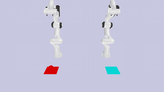
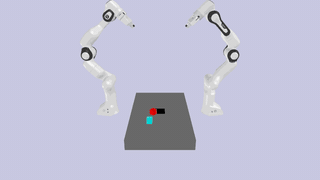
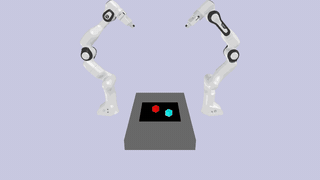
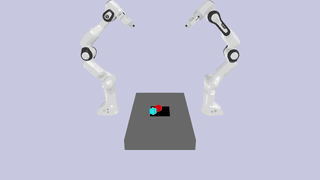
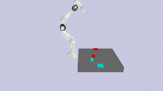
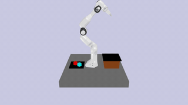
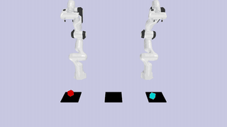
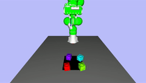

<!--
Copyright (c) 2026, NVIDIA CORPORATION & AFFILIATES. All rights reserved.

NVIDIA CORPORATION, its affiliates and licensors retain all intellectual
property and proprietary rights in and to this material, related
documentation and any modifications thereto. Any use, reproduction,
disclosure or distribution of this material and related documentation
without an express license agreement from NVIDIA CORPORATION or
its affiliates is strictly prohibited.
-->
# ScheduleStream

<!--Temporal Planning with Samplers for Robot Task and Motion Planning (TAMP)-->

ScheduleStream is a framework for planning & scheduling with continuous sampling operations 
motivated by the application of multi-arm robot Task and Motion Planning (TAMP).
See the following ICRA 2026 [paper](https://arxiv.org/abs/2511.04758) for motivation & background, 
a tutorial on the ScheduleStream planning language, and a description of several ScheduleStream algorithms.

ScheduleStream is domain independent and thus both supports different robotics backends 
and can even be applied to applications beyond robotics. The currently supported applications are:
* [cuStream2](#custream2) (recommended): TAMP w/ [cuRoboV2](https://nvlabs.github.io/curobo/latest/)
* [IsaacLab](#isaaclab): TAMP automated demonstration generation ([DemoStream](http://demostream.github.io))
* [cuMotion](#cumotion): TAMP w/ [cuMotion](https://nvidia-isaac.github.io/cumotion/index.html)
* [cuStream](#custream-deprecated) (deprecated): TAMP w/ [cuRobo](https://curobo.org/) v1
* [Trimesh 2D](#trimesh-2d): TAMP in a 2D plane w/ [trimesh](https://trimesh.org/)
* [Blocksworld](#blocksworld): Discrete sequential and temporal planning in [blocksworld](https://en.wikipedia.org/wiki/Blocks_world) 


### [🌐 Project Website](https://schedulestream.github.io/) | [📝 Paper](https://arxiv.org/abs/2511.04758)

> **ScheduleStream: Temporal Planning with Samplers for GPU-Accelerated Multi-Arm Task and Motion Planning & Scheduling**
> [Caelan Garrett](http://web.mit.edu/caelan/)<sup>1</sup>,
> [Fabio Ramos](https://fabioramos.github.io/Home.html)<sup>1,2</sup>.
> <sup>1</sup>[NVIDIA Research](https://www.nvidia.com/en-us/research/),
> <sup>2</sup>[University of Sydney](https://www.sydney.edu.au/),
> _IEEE International Conference on Robotics and Automation (**ICRA**), 2026_

<!--iframe width="854" height="480" src="https://www.youtube.com/embed/0LyTPmAXaQY?si=xrlXG1MDRjbqXBUm" title="YouTube video player" frameborder="0" allow="accelerometer; autoplay; clipboard-write; encrypted-media; gyroscope; picture-in-picture; web-share" referrerpolicy="strict-origin-when-cross-origin" allowfullscreen></iframe-->

[](https://www.youtube.com/watch?v=0LyTPmAXaQY)

```bibtex
@inproceedings{garrett2025schedulestream,
    title={ScheduleStream: Temporal Planning with Samplers for GPU-Accelerated Multi-Arm Task and Motion Planning & Scheduling},
    author={Garrett, Caelan and Ramos, Fabio},
    booktitle={2026 IEEE International Conference on Robotics and Automation (ICRA)},
    year={2026},
    organization={IEEE}
}
```

## DemoStream

[DemoStream](http://demostream.github.io) uses ScheduleStream for automated demonstration generation and imitation learning: 
batched, GPU-accelerated TAMP optimization produces high-quality demonstrations for training behavior cloning policies.
See the [supplementary video](http://demostream.github.io/assets/videos/supplementary.mp4) for an overview.

### [🌐 Project Website](http://demostream.github.io) | [📝 Paper](https://arxiv.org/abs/2610.22020)

> **DemoStream: Batched Task-and-Motion-Plan Optimization for Automated Learning from Demonstration**
> [Caelan Garrett](http://web.mit.edu/caelan/)<sup>1</sup>,
> Neel Jawale<sup>1</sup>,
> [Fabio Ramos](https://fabioramos.github.io/Home.html)<sup>1,2</sup>.
> <sup>1</sup>[NVIDIA Research](https://www.nvidia.com/en-us/research/),
> <sup>2</sup>[University of Sydney](https://www.sydney.edu.au/),
> _arXiv preprint, 2026_

```bibtex
@article{garrett2026demostream,
    title={DemoStream: Batched Task-and-Motion-Plan Optimization for Automated Learning from Demonstration},
    author={Garrett, Caelan and Jawale, Neel and Ramos, Fabio},
    journal={arXiv preprint arXiv:2610.22020},
    year={2026}
}
```

## Installation

Minimal installation instructions:

```bash
$ git clone git@github.com:NVlabs/ScheduleStream.git
$ cd ScheduleStream
ScheduleStream$ pip install -e .
```
<!-- ScheduleStream$ git submodule update --init --recursive -->

This installs the planning language and algorithms, which run the [minimal example](#applications).
To get started with robot task and motion planning, follow the [cuStream2](#custream2) installation
(the recommended application); other applications list their own dependencies.

## Documentation

* [Planning language](src/schedulestream/language/README.md): a walkthrough of constants, predicates, actions, durative actions, streams, and problems
* [Algorithms](src/schedulestream/algorithm/README.md): the stream, finite, scheduling, and search algorithms and their arguments

## Applications <!-- Examples -->

Minimal example that serves as a tutorial (mirroring the [paper](https://arxiv.org/abs/2511.04758)): 
```bash
ScheduleStream$ ./src/schedulestream/applications/minimal.py
```

The currently supported applications are:
* [cuStream2](#custream2) (recommended): TAMP w/ [cuRoboV2](https://nvlabs.github.io/curobo/latest/)
* [IsaacLab](#isaaclab): TAMP automated demonstration generation ([DemoStream](http://demostream.github.io)) in [IsaacLab](https://isaac-sim.github.io/IsaacLab/main/index.html)
* [cuMotion](#cumotion): TAMP w/ [cuMotion](https://nvidia-isaac.github.io/cumotion/index.html)
* [cuStream](#custream-deprecated) (deprecated): TAMP w/ [cuRobo](https://curobo.org/) v1
* [Trimesh 2D](#trimesh-2d): TAMP in a 2D plane w/ [trimesh](https://trimesh.org/)
* [Blocksworld](#blocksworld): Discrete sequential and temporal planning in [blocksworld](https://en.wikipedia.org/wiki/Blocks_world) 


### cuStream2

TAMP with [cuRoboV2](https://nvlabs.github.io/curobo/latest/) collision and inverse kinematics primitives

This is the recommended TAMP application: multi-arm planning with batched, GPU-resident
grasp, placement, and inverse kinematics streams and several motion planners.
See [cuStream2](src/schedulestream/applications/custream2/) for what is new, the full list of
options, troubleshooting, and citation.

> **Note:** This example uses cuRoboV2, installed from [source](https://github.com/NVlabs/curobo) at a pinned commit.

#### Installation

Requires Linux, an NVIDIA GPU with a recent driver, and Python 3.10+. No CUDA toolkit is needed:
the `custream2` extra installs a CUDA-enabled torch and cuRoboV2 (at a pinned commit) with plain pip.

```bash
$ git clone git@github.com:NVlabs/ScheduleStream.git
$ cd ScheduleStream
ScheduleStream$ python3 -m venv .venv && source .venv/bin/activate
(.venv) ScheduleStream$ pip install -e ".[custream2]" --extra-index-url https://download.pytorch.org/whl/cu130
```

For a driver that only supports CUDA 12.x, use `".[custream2-cu12]"` with
`--extra-index-url https://download.pytorch.org/whl/cu128`.

Verify the installation (no display needed):

```bash
(.venv) ScheduleStream$ ./src/schedulestream/applications/custream2/example.py --task hold --headless
```

#### Examples

Add `--headless` to plan without a display and `--video gif` to record the execution.

#### Hold

```bash
ScheduleStream$ ./src/schedulestream/applications/custream2/example.py --task hold
```



#### Stack

```bash
ScheduleStream$ ./src/schedulestream/applications/custream2/example.py --task stack
```



#### Pack

```bash
ScheduleStream$ ./src/schedulestream/applications/custream2/example.py --task pack
```



#### Unpack

```bash
ScheduleStream$ ./src/schedulestream/applications/custream2/example.py --task unpack
```



#### Sort

```bash
ScheduleStream$ ./src/schedulestream/applications/custream2/example.py --task sort
```



#### Stand

```bash
ScheduleStream$ ./src/schedulestream/applications/custream2/example.py --task stand
```



#### Relay

```bash
ScheduleStream$ ./src/schedulestream/applications/custream2/example.py --task relay
```



### IsaacLab

TAMP Demonstration Generation in IsaacLab

See [IsaacLab TAMP Demonstration Generation](src/schedulestream/applications/isaaclab/)


### cuMotion

TAMP with [cuMotion](https://nvidia-isaac.github.io/cumotion/index.html) collision and inverse kinematics primitives

See [ScheduleStream with cuMotion](src/schedulestream/applications/cumotion/)




### cuStream (deprecated)

TAMP with [cuRobo](https://curobo.org/) collision and inverse kinematics primitives

> **Deprecated:** This example uses cuRoboV1, pinned to tag [v0.7.8](https://github.com/NVlabs/curobo/tree/v0.7.8).

Superseded by [cuStream2](#custream2), which is the recommended TAMP application.
See [cuStream](src/schedulestream/applications/custream/) for additional utility scripts for
URDF visualization, collision sphere computation, and YAML robot config computation.

#### Installation

Install cuRobo: [instructions](https://curobo.org/get_started/1_install_instructions.html)

```bash
$ git clone --branch v0.7.8 https://github.com/NVlabs/curobo.git
$ cd curobo
curobo$ pip install -e . --no-build-isolation
curobo$ cd ../ScheduleStream
ScheduleStream$ pip install -e .[custream]
```

#### Tutorial

```bash
ScheduleStream$ ./src/schedulestream/applications/custream/tutorial.py
```

#### Hold

```bash
ScheduleStream$ ./src/schedulestream/applications/custream/example.py --task hold
```


#### Stack

```bash
ScheduleStream$ ./src/schedulestream/applications/custream/example.py --task stack
```


#### Pack

```bash
ScheduleStream$ ./src/schedulestream/applications/custream/example.py --task pack
```


### Trimesh 2D

TAMP and motion planning in a 2D plane with [trimesh](https://trimesh.org/) collision primitives

#### Installation

```bash
ScheduleStream$ pip install -e .[trimesh2d]
```

#### TAMP

```bash
ScheduleStream$ ./src/schedulestream/applications/trimesh2d/tamp.py
```


#### Motion Planning

```bash
ScheduleStream$ ./src/schedulestream/applications/trimesh2d/motion.py
```


### Blocksworld

Discrete [blocksworld](https://en.wikipedia.org/wiki/Blocks_world) planning

#### Temporal

```bash
ScheduleStream$ ./src/schedulestream/applications/blocksworld/sequential.py
```


#### Sequential

```bash
ScheduleStream$ ./src/schedulestream/applications/blocksworld/temporal.py
```


## Tests

```bash
ScheduleStream$ pip install -e .[test]
ScheduleStream$ pytest
```

Tests for applications whose dependencies are not installed (for example cuStream2 without cuRoboV2) are skipped.

## License

ScheduleStream is released under the NVIDIA License (non-commercial use). See [LICENSE](LICENSE) for the full terms.

## Third-Party Software

This project will download and install additional third-party open source software projects. Review the license terms of these open source projects before use.
