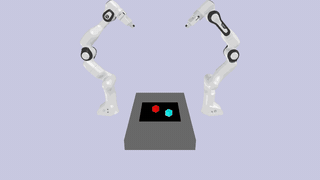
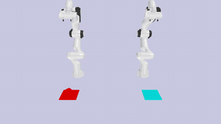
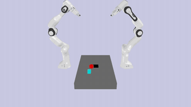
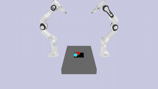
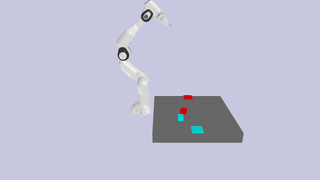
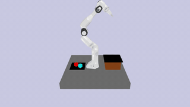
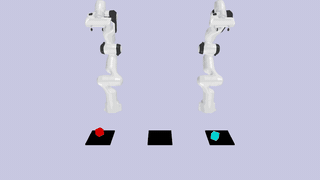

<!--
Copyright (c) 2026, NVIDIA CORPORATION & AFFILIATES. All rights reserved.

NVIDIA CORPORATION, its affiliates and licensors retain all intellectual
property and proprietary rights in and to this material, related
documentation and any modifications thereto. Any use, reproduction,
disclosure or distribution of this material and related documentation
without an express license agreement from NVIDIA CORPORATION or
its affiliates is strictly prohibited.
-->
# cuStream2

The recommended ScheduleStream application: multi-arm Task and Motion Planning (TAMP) with
[cuRoboV2](https://nvlabs.github.io/curobo/latest/) collision and inverse kinematics primitives.
cuStream2 supersedes [cuStream](../custream/), which targets cuRoboV1.



Installation and examples repeated from: [README](../../../../README.md#custream2)

## What's new

cuStream2 plans with **batched, GPU-resident samplers**. Instead of generating one grasp,
placement, or inverse kinematics solution at a time, the main ScheduleStream streams are evaluated on a
whole batch of candidates at once (`--batch`, default 128), and cuRoboV2 checks collisions and
solves IK for the entire batch on the GPU.

* **Batched streams:** the grasp, placement, and pick/place inverse kinematics streams take and
  return batches ([`streams.py`](streams.py), [`placement.py`](placement.py),
  [`grasp.py`](grasp.py)), and the roadmap motion planners check all candidate edges at once on
  the GPU. The planner solves streams with the batch satisfier
  ([`batch_satisfier.py`](../../algorithm/stream/batch_satisfier.py)).
* **Multi-arm temporal planning:** `move`, `pick`, and `place` are durative actions
  ([`tamp.py`](tamp.py)), so arms act concurrently. Collisions between simultaneously executing
  arm trajectories, and between trajectories and objects, are conditions on the actions.
* **Choice of motion planner:** `--motion` selects the cuRobo planner (`curobo`), a GPU-batched
  configuration-space PRM roadmap (`joint`, [`joint_prm.py`](joint_prm.py)), an SE(3) tool-pose
  PRM (`task`, [`task_prm.py`](task_prm.py)), or straight-line interpolation with no
  collision checking (`linear`). `joint` accepts a distance-cost suffix, e.g.
  `joint:sphere`.
* **Optimized schedules:** the plan is retimed and its concurrent trajectories are combined into
  a single timed command sequence by a MILP ([`postprocess.py`](postprocess.py),
  [`retime.py`](retime.py)).
* **Object primitives:** cuboids, spheres, cylinders, capsules, and YCB meshes
  (`--primitive`).

## Requirements

* Linux with an NVIDIA GPU and a recent driver (580+ for the default CUDA 13 build)
* Python 3.10 or newer (tested with 3.12)

No CUDA toolkit or `nvcc` is needed: the `custream2` extra installs a CUDA-enabled torch from
PyTorch's wheel index and cuRoboV2 (pinned in `pyproject.toml` to the commit this release was
tested with).

## Installation

```bash
$ git clone git@github.com:NVlabs/ScheduleStream.git
$ cd ScheduleStream
ScheduleStream$ python3 -m venv .venv && source .venv/bin/activate
(.venv) ScheduleStream$ pip install -e ".[custream2]" --extra-index-url https://download.pytorch.org/whl/cu130
```

Any Python environment manager works (for example `conda create -n custream2 python=3.12`). The
`--extra-index-url` is required to get the CUDA build of torch; pip does not read uv's index
configuration, so use plain pip.

For an older driver that only supports CUDA 12.x, use the CUDA 12 extra and wheel index:

```bash
(.venv) ScheduleStream$ pip install -e ".[custream2-cu12]" --extra-index-url https://download.pytorch.org/whl/cu128
```

Verify the installation by planning a small task without a display:

```bash
(.venv) ScheduleStream$ ./src/schedulestream/applications/custream2/example.py --task hold --headless
```

A successful run ends with the timed commands (`combine_timed_commands) Commands: ...`).

## Quick start

Run an example and open the viewer:

```bash
ScheduleStream$ ./src/schedulestream/applications/custream2/example.py --task stack
```

Or from Python:

```python
from schedulestream.applications.custream2.example import plan_example

state, commands = plan_example(task="stack", num=2)  # commands is None if planning fails
print(len(commands.commands))
```

## Examples

Every example takes the options below. Add `--headless` to plan without a display and
`--video gif` (or `mp4`) to record the execution into `videos/`.

### Hold

Each arm picks up an object and holds it.

```bash
ScheduleStream$ ./src/schedulestream/applications/custream2/example.py --task hold
```



### Stack

Stack the objects on top of one another on a small platform; they start on the floor.

```bash
ScheduleStream$ ./src/schedulestream/applications/custream2/example.py --task stack
```



### Pack

Move the objects from the floor onto a large platform, sharing the work between two arms.

```bash
ScheduleStream$ ./src/schedulestream/applications/custream2/example.py --task pack
```


### Unpack

Move the objects from the platform onto the floor.

```bash
ScheduleStream$ ./src/schedulestream/applications/custream2/example.py --task unpack
```



### Sort

Move each object onto its own platform.

```bash
ScheduleStream$ ./src/schedulestream/applications/custream2/example.py --task sort
```



### Stand

A single arm places the objects onto an elevated stand.

```bash
ScheduleStream$ ./src/schedulestream/applications/custream2/example.py --task stand
```



### Relay

Two arms on opposite sides move objects from their outer platforms to a shared middle platform, coordinating their motions.

```bash
ScheduleStream$ ./src/schedulestream/applications/custream2/example.py --task relay
```



### Options

| Option | Description |
| --- | --- |
| `--task` | Task: `hold`, `stack`, `pack`, `unpack`, `sort`, `stand`, `relay`, plus `motion`, `tight`, `blocked`, `ycb`, `floor`. |
| `-n`, `--num` | Number of objects (default 2). |
| `--single` | Use a single arm when the task supports it. |
| `--primitive` | Object primitive: `cuboid`, `sphere`, `cylinder`, `capsule`, `ycb`. |
| `--cost` | Distance function for the action costs: `joint` (default), `task`, `zero`, `random`, `sphere`, `task-position`, `task-rotation`, `task-sphere`. |
| `-m`, `--motion` | Motion planner: `joint` (default), `curobo`, `task`, or `linear`. `joint` accepts a cost suffix, e.g. `joint:task`. |
| `-b`, `--batch` | Stream batch size (default 128). |
| `-c`, `--cfree` | Ignore collisions. |
| `--max-time` | Solver time limit in seconds (default 60). |
| `-s`, `--seed` | Random seed (default 0). |
| `--scenes` | Number of consecutive scenes to run. |
| `--headless` | Disable the viewer. |
| `-v`, `--video` | Record a video (`mp4`, `gif`, ... or an output path). |
| `-d`, `--debug` | Run with debug streams. |
| `-p`, `--profile` | Profile the run. |

Run with `--help` for the full list.

### Costs and motion planners

`--cost` sets the distance that the planner minimizes when choosing among grasps, placements and
configurations, and `--motion` sets the low-level planner. The
[DemoStream](http://demostream.github.io) paper ablates these choices; its names correspond to the options as follows:

| Paper | `--cost` | `--motion` |
| --- | --- | --- |
| Zero cost | `zero` | |
| Joint-space cost | `joint` | |
| Task-space cost | `task` | |
| cuRoboV2 trajectory optimizer | | `curobo` |
| J-PRM (joint-space PRM, joint-space cost) | | `joint` |
| J-PRM:T (joint-space PRM, task-space cost) | | `joint:task` |
| T-PRM (task-space PRM) | | `task` |

Larger `--batch` values explore more candidate solutions in parallel per stream call. A batch size of
1 is comparable to sequential, CPU-style TAMP.

## Scripts

cuStream2 utility scripts. Run with `--help` to see all options.

### Scene Visualization

Create and visualize a Franka scene (defaults to the `platforms` scene):

```bash
ScheduleStream$ ./src/schedulestream/applications/custream2/scene.py [SCENE] [-n NUM_SCENES] [--num-robots N] [--num-objects N] [--primitive PRIMITIVE] [--spheres] [--seed SEED]
```

### State Sampling

Sample and animate collision-free placement states for a Franka scene (defaults to the `unpack` scene):

```bash
ScheduleStream$ ./src/schedulestream/applications/custream2/initialize.py [SCENE] [--num-states N] [--num-objects N] [--steps-per-state N] [--distance D] [--reachable] [--headless] [--video] [--spheres] [--seed SEED]
```

## Tests

```bash
ScheduleStream$ pytest tests/custream2_test.py
```

The tests require a GPU and are skipped when cuRoboV2 is not installed.

## Troubleshooting

* **`custream2 requires cuRoboV2`:** the env has cuRoboV1 or no cuRobo. cuStream and cuStream2
  need different cuRobo versions, so use a separate env for each.
* **`torch.cuda.is_available()` is False:** torch was installed without the `--extra-index-url`
  CUDA wheels, or the driver is too old for CUDA 13. Reinstall with the matching extra
  (`custream2` or `custream2-cu12`) and wheel index.
* **No display available:** pass `--headless`.
